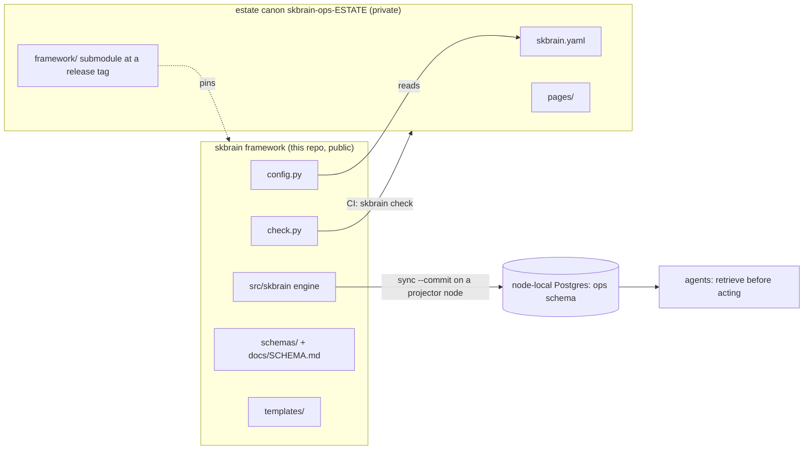

# skbrain: Standard Operating Procedures

The operations-brain framework: the engine, schema and checks an estate uses to keep
its runbooks, known errors and postmortems as reviewed pages and project them for
retrieval. Called by estate canon CI (`skbrain check`) and by the projector timer
(`skbrain sync --commit`).

## 1. Overview

Purpose: one versioned, scrubbed framework that any estate can pin. It owns the page
schema, the slug and link rules, the check, the projector engine and the templates.

It does NOT own: the Postgres DDL (the memory system owns it), the installer pack (the
`skos` installer owns it), any estate's pages, any hostname, address, person or secret.

## 2. Architecture



Start here:

| File | What |
|---|---|
| `src/skbrain/cli.py` | Every command |
| `src/skbrain/check.py` | The instance CI check |
| `src/skbrain/config.py` | `skbrain.yaml` and the estate guard |
| `src/skbrain/parser.py` | Page parsing; `walk_pages` reads only `pages/` |
| `docs/SCHEMA.md` | The page schema (normative) |

## 3. Build

Python 3.11 or newer.

```bash
python3 -m venv .venv && . .venv/bin/activate
pip install -e ".[dev]"
```

Build a wheel: `pip wheel . --no-deps -w dist/`. The wheel ships the schemas and the
vendored skrsi vocabulary.

## 4. Test

```bash
pytest -q
python3 scripts/validate_public.py
skbrain check --canon templates/instance-repo --repo-name skbrain-ops-example
```

All three must pass before a merge. CI runs them, plus the docs gate.

## 5. Release / Deploy

Library: build and publish.

1. Update `CHANGELOG.md` and the `version` in `pyproject.toml` (SemVer).
2. Run the scrub check as a release run: `SKBRAIN_SCRUB_RELEASE=1 python3 scripts/validate_public.py --denylist <private denylist file>`.
3. Tag `skbrain-vX.Y.Z` on `main`. Instances pin that exact tag.
4. Regenerate the public instance template: `scripts/generate-instance-template.sh <dir>`.

Instances upgrade by a pull request that bumps their `framework/` submodule and the
`framework:` field of `skbrain.yaml`; their CI runs the new framework's check first.
Front-end / Exposure: N/A, no network surface (the projector talks to a local database).

## 6. Configuration / Usage

| Variable | Meaning |
|---|---|
| `SKBRAIN_CANON` | The canon checkout. No default: unset means every canon command exits 2 |
| `SKBRAIN_ESTATE` | The node's declared estate. When set, `sync --commit` refuses a canon of another estate |
| `SKBRAIN_PG_PROJECTOR_DSN` | Projector login (read and write on the `ops` schema) |
| `SKBRAIN_PG_READER_DSN` | Reader login (select only) |
| `SKBRAIN_SCRUB_DENYLIST` | Private denylist file for `scripts/validate_public.py` |
| `SKBRAIN_SCRUB_RELEASE` | `1` makes a missing denylist a hard failure |

The per-estate config is `skbrain.yaml` in the canon; see `docs/INSTANCE-MODEL.md`.

## 7. API / Reference

CLI: see the README table. Library entry points: `skbrain.parser.walk_pages`,
`skbrain.check.run_check`, `skbrain.config.load_config`, `skbrain.config.estate_guard`,
`skbrain.writer.project`.

## 8. Troubleshooting

| Symptom | Check |
|---|---|
| `no canon selected` | Pass `--canon` or set `SKBRAIN_CANON`; there is no default on purpose |
| `skbrain check` fails with `estate-repo-name` | The repo must be named `skbrain-ops-<estate>`; in CI pass `--repo-name` |
| `refusing to project this canon` | `SKBRAIN_ESTATE` differs from `skbrain.yaml`, or this host is not in `projector_nodes` |
| `skbrain:pin` red in doctor | Installed version, `framework:` in `skbrain.yaml` and the submodule tag must be equal |
| `validate_public.py` exits 2 | A release run needs a denylist; pass `--denylist` |
| search shows `timeout` for an arm | A slow retrieval arm is not "no results"; check `skbrain doctor` |

## 9. Maturity-tier + Version reference

T0 (N/A, no key material). Phase: Active v1. Version 1.0.0 (SemVer). Docs freshness:
this SOP carries the evidence block below.

<!-- docs-evidence
verified: 2026-11-14
checks:
  - name: console script entry point is declared
    run: grep -q 'skbrain = "skbrain.cli:app"' pyproject.toml
  - name: instance schema present
    run: test -f schemas/skbrain-instance-v1.schema.json
  - name: page schema present
    run: test -f schemas/page-frontmatter-v1.schema.json
  - name: scrub script present
    run: test -f scripts/validate_public.py
  - name: canon is resolved from the environment, with no default
    run: grep -q 'SKBRAIN_CANON' src/skbrain/config.py
-->
